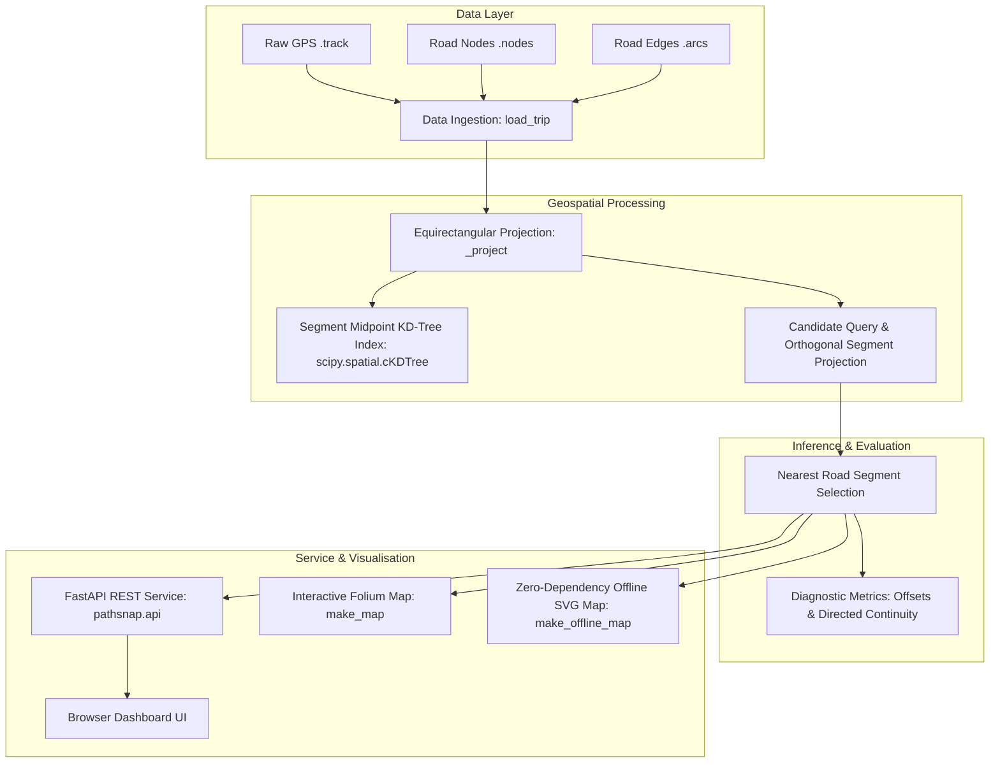

# PathSnap: Distributed Map-Matching & Route Reconstruction

## Contributors

| Team Member | Responsibility |
|---|---|
| PES1UG24AM004 | Experimentation, evaluation and optimisation |
| PES1UG24AM005 | Data processing and EDA |
| PES1UG24AM006 | Feature engineering, ML models and HMM |
| PES1UG24AM007 | API, UI and visualisation |

## 1. Project Description

**PathSnap** is a machine learning and geospatial processing system designed to match noisy GPS trajectory sequences to a directed road network. Developed for course **UE24CS352A (Machine Learning)**, the project addresses the spatial misalignment inherent in real-world location tracking by projecting raw GPS observations onto road segments and reconstructing plausible topological routes.

---

## 2. Problem Statement

Consumer-grade GPS receivers in urban environments routinely suffer from multipath degradation, satellite signal attenuation, building occlusions, and irregular sampling intervals. Raw recorded trajectories exhibit spatial drift, position jumps across city blocks, and offset from actual roadways. 

The challenge of **map-matching** is to infer the true sequence of road segments traversed by an agent given noisy discrete spatial observations $(p_1, p_2, \dots, p_N)$ and a directed road network graph $G = (V, E)$, while handling irregular temporal sampling and geometric noise.

---

## 3. Project Objectives

- **Robust Ingestion & Validation:** Parse and validate heterogeneous GPS traces and road network graphs across partitions without data leakage.
- **Geospatial Metric Alignment:** Project angular coordinates (longitude/latitude) into metric Cartesian space to enable accurate Euclidean distance calculations.
- **Candidate Indexing & Projection:** Implement efficient spatial indexing ($k$-d trees) to identify candidate road segments and compute exact orthogonal projections.
- **Evaluation Diagnostics:** Compute diagnostic metrics including offset distributions (mean, median, 95th percentile) and topological directed edge continuity.
- **Service Deployment & Visualisation:** Expose a lightweight REST API and interactive web interface with both dynamic Leaflet/Folium mapping and standalone offline SVG visualization.

---

## 4. Dataset Structure & File Descriptions

The dataset consists of two partitions: `train/` (80 trips) and `student_test/` (10 development trips). Each individual trip folder contains four headerless, whitespace-separated text files:

| File Extension | Content | Format / Columns | Description |
|---|---|---|---|
| `.track` | GPS Observations | `longitude, latitude, timestamp` | Sequential discrete GPS fixes with Unix epoch timestamp in seconds. |
| `.nodes` | Road Graph Vertices | `longitude, latitude` | Spatial coordinates of graph intersections/endpoints. The 0-based row index defines the `node_id`. |
| `.arcs` | Directed Road Edges | `from_node_id, to_node_id` | Directed road segments connecting two nodes. The 0-based row index defines the `arc_id`. |
| `.route` | Reference Trajectory | `arc_id` | Chronological ground-truth sequence of traversed directed edges (used strictly for offline validation). |

### Dataset Directory Layout

```text
data/
├── README.md
├── Student folder.zip       <- (Local raw archive; excluded from Git)
└── Student folder/          <- (Extracted dataset)
    ├── train/               <- 80 training trips (00000001 to 00000099)
    └── student_test/        <- 10 evaluation trips (e.g., 00000000, 00000052, 00000076)
```

---

## 5. System Architecture

The PathSnap system is structured as a modular pipeline:



---

## 6. Technical Implementation

### Local Metric Projection
Angular coordinates in degrees (WGS84) are projected to a local metric Cartesian plane centered on the mean trajectory coordinate $(\lambda_0, \phi_0)$:

$$x = (\lambda - \lambda_0) \times 111320 \times \cos(\phi_0)$$
$$y = (\phi - \phi_0) \times 110540$$

This eliminates latitude-dependent longitudinal distortion without the computational overhead of full geodetic transforms.

### Candidate Spatial Indexing
Road segment midpoints $m_e = \frac{v_{\text{start}} + v_{\text{end}}}{2}$ are indexed using a balanced $k$-d tree (`scipy.spatial.cKDTree`). For each projected GPS point $p_i$, the $k$ nearest candidate road segments are queried in $O(\log |E|)$ time.

### Orthogonal Point-to-Segment Projection
For each candidate directed segment defined by start vector $s$ and segment direction vector $v = e - s$:

$$t = \text{clip}\left(\frac{(p - s) \cdot v}{\|v\|^2}, 0, 1\right)$$
$$\text{proj}(p) = s + t \cdot v$$
$$\text{dist}(p, \text{segment}) = \|p - \text{proj}(p)\|$$

The segment minimizing Euclidean projection distance is selected as the candidate match.

### Directed Edge Continuity Metric
To measure whether consecutive predicted road segments form a valid traversable sequence in the road graph, directed continuity is calculated:

$$\text{Continuity} = \frac{1}{N-1} \sum_{i=1}^{N-1} \mathbb{I}\left(\text{arcs}[\hat{a}_i, \text{to\_node}] = \text{arcs}[\hat{a}_{i+1}, \text{from\_node}]\right)$$

---

## 7. Installation Instructions

### Prerequisites
- Python 3.10, 3.11, or 3.12
- Git

### Setup Steps
```bash
# 1. Clone repository
git clone https://github.com/PES1UG24AM004/ML-Hackathon.git
cd ML-Hackathon

# 2. Create virtual environment
python -m venv .venv

# 3. Activate virtual environment
# On Windows:
.venv\Scripts\activate
# On Linux/macOS:
source .venv/bin/activate

# 4. Install dependencies
pip install -r requirements.txt
```

### Dataset Setup
1. Place the supplied `Student folder.zip` into the `data/` directory.
2. Extract the dataset:
   ```bash
   python scripts/extract_dataset.py
   ```

---

## 8. Execution Instructions

### One-Click Windows Launch
Double-click `START_DEMO.bat`. The launcher verifies the environment, extracts the dataset, generates EDA outputs if missing, and launches the web interface at `http://127.0.0.1:8000`.

### Command Line Execution
```bash
# Run exploratory data analysis over all training and test trips
python scripts/run_eda.py

# Run baseline demonstration on a specific trip (e.g. 00000052)
python scripts/run_baseline_demo.py 00000052

# Run baseline evaluation across all 10 student-testing trips
python scripts/summarize_student_baseline.py

# Launch FastAPI web application
python -m uvicorn pathsnap.api:app --app-dir src --host 127.0.0.1 --port 8000
```

---

## 9. API Endpoints

The FastAPI service exposes the following REST endpoints:

| Method | Endpoint | Description | Response / Payload |
|---|---|---|---|
| `GET` | `/` | Web Dashboard UI | Embedded HTML/JS dashboard for selecting trips and visualising results. |
| `GET` | `/health` | Service Health Check | `{"status": "ok", "data_root_exists": true}` |
| `GET` | `/api/trips` | Trip Enumeration | `{"partition": "student_test", "trips": ["00000000", ...]}` |
| `POST` | `/api/match/{trip_id}` | Map-Matching Inference | Executes point-to-segment projection for the requested trip and returns diagnostic metrics and map URLs. |
| `GET` | `/offline-maps/{trip_id}.html` | Offline SVG Map | Self-contained, zero-dependency interactive SVG trajectory visualization. |
| `GET` | `/maps/{trip_id}.html` | Interactive Folium Map | Multi-layer Leaflet map with raw GPS, snapped predictions, and nearby road edges. |

---

## 10. Current Implementation & Limitations

### Implemented Functionality
- Full parsing and validation of `.track`, `.nodes`, and `.arcs`.
- Local metric projection and spatial $k$-d tree candidate retrieval.
- Point-to-segment geometric snapping baseline.
- Cross-trip benchmark execution across all 10 student-testing trips.
- Standalone SVG and Folium map rendering.
- FastAPI REST service and web interface.

### Summary of Baseline Results (Student Testing Partition)

| Trip ID | GPS Observations | Road Segments | Median Snap Offset | 95th Percentile Offset | Directed Continuity |
|:-------:|:----------------:|:-------------:|:------------------:|:----------------------:|:-------------------:|
| 00000000 | 2,503 | 18,196 | 6.02 m | 31.15 m | 25.46% |
| 00000007 | 1,354 | 4,369 | 4.60 m | 27.54 m | 32.82% |
| 00000009 | 1,049 | 13,106 | 4.14 m | 16.25 m | 32.63% |
| 00000040 | 2,995 | 27,026 | 5.07 m | 33.17 m | 24.72% |
| 00000052 | 262 | 3,577 | 3.49 m | 12.54 m | 24.14% |
| 00000056 | 3,958 | 27,631 | 4.46 m | 15.07 m | 28.43% |
| 00000065 | 768 | 13,184 | 4.31 m | 16.57 m | 21.25% |
| 00000076 | 1,486 | 56,027 | 6.14 m | 18.84 m | 33.67% |
| 00000077 | 3,911 | 9,622 | 5.98 m | 19.57 m | 30.33% |
| 00000091 | 874 | 12,303 | 3.79 m | 13.17 m | 26.58% |

### Known Limitations & Future Work
- **Lack of Sequential Regularisation:** Independent point-by-point geometric snapping frequently matches to adjacent parallel or intersecting segments, resulting in low directed topological continuity (~21–34%).
- **Planned Sequence Decoding:** Future iterations will implement Hidden Markov Model (HMM) sequence decoding with Viterbi search, combining emission probabilities (spatial distance) and transition probabilities (routing distance along graph edges).
- **Candidate Feature Engineering:** Extraction of speed, heading differences, and graph connectivity features for learned classification models.

---

## 11. Team Members

- **PES1UG24AM004**
- **PES1UG24AM005**
- **PES1UG24AM006**
- **PES1UG24AM007**
